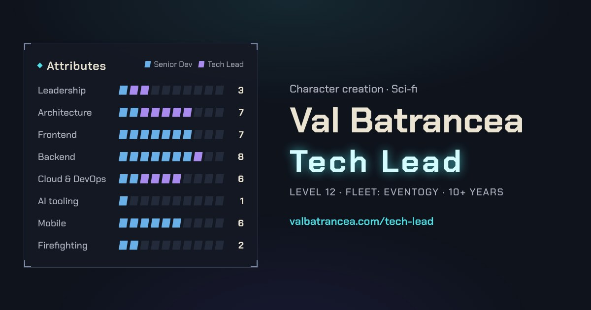
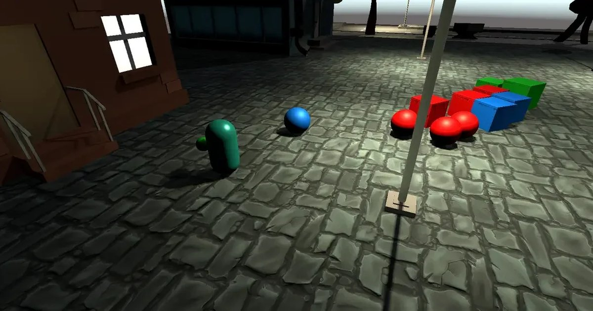

### Hi, I'm Val

Engineering lead with over 10 years building event management SaaS for enterprise clients. I work across the stack (TypeScript, React, Next.js, PHP/Laravel, AWS) and I'm hands-on with AI-assisted development.

This is where my personal projects live.

<table>
  <tr>
    <td width="50%" valign="top">
      
      
<strong><a href="https://valbatrancea.com">valbatrancea.com</a></strong>

      
My portfolio, built as a video game character creation screen. Pick a class and the world, hats and stats change with it.

      
Next.js · React · TypeScript

      
<a href="https://valbatrancea.com">Visit the site</a> · <a href="https://valbatrancea.com/devlog/valbatrancea">Devlog</a>

    </td>
    <td width="50%" valign="top">
      
      
<strong><a href="https://play.unity.com/en/games/fd848a0a-d7b5-4bc0-8ae3-d4498bea3732/the-shapes-and-colours-v06">The Shapes and Colours</a></strong>

      
An arena shooter made in Unity. Each shape and colour only takes damage from the matching weapon, and the rule switches as the difficulty climbs.

      
Unity · C#

      
<a href="https://play.unity.com/en/games/fd848a0a-d7b5-4bc0-8ae3-d4498bea3732/the-shapes-and-colours-v06">Play in browser</a> · <a href="https://valbatrancea.com/devlog/shapes-and-colours">Devlog</a>

    </td>
  </tr>
</table>

**Find me**

[valbatrancea.com](https://valbatrancea.com) · [LinkedIn](https://www.linkedin.com/in/valbatrancea)
